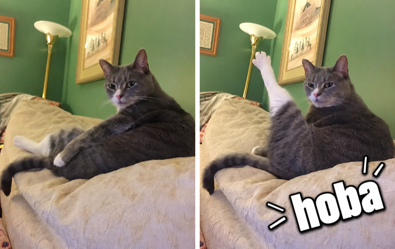

# Hoba

An embedded full-text search engine library in pure Go, based on the Tantivy/Lucene architecture.

Work in progress.

## Naming

Named after the Russian cat meme: a cat abruptly throws its paw up and declares **«хоба!»** — a sudden, effortless "ta-da!"

## License

MIT
